# Network Assessment and Hardening Lab

A full assess, harden and verify cycle in an isolated VMware network: scanning and enumerating an Ubuntu web server from Kali Linux, hardening it, then scanning again to measure which measures actually worked.

> **Status:** One cycle completed. The firewall works and the default page is gone. The Apache version is still exposed because of one wrong configuration line, and removing the default page introduced a directory listing. Both are planned for the next run.

> **Kurzfassung (DE):** Ein kompletter Durchlauf im isolierten VMware-Netz: Ubuntu-Webserver von Kali aus prüfen, härten und danach erneut messen. Der Re-Scan zeigt 998 gefilterte Ports, die Standardseite ist weg. Offen sind die weiterhin sichtbare Apache-Version, ein neues Verzeichnislisting und fehlende Security-Header.

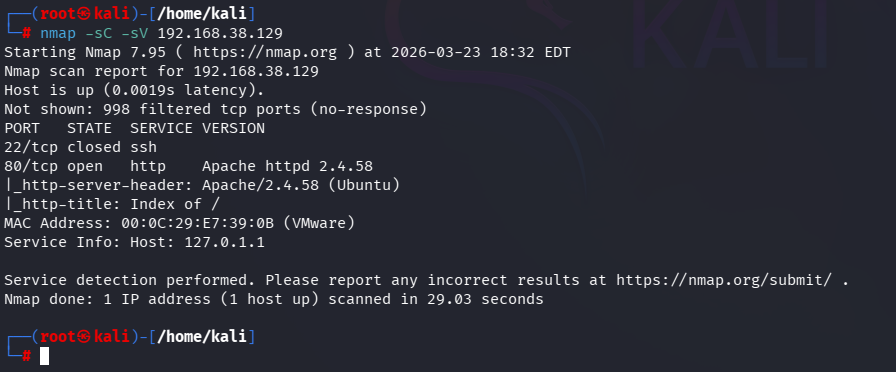

## Lab environment

| Component | Details |
|---|---|
| Attacker | Kali Linux, 192.168.38.131 |
| Target | Ubuntu Desktop with Apache2, 192.168.38.129 |
| Platform | VMware Workstation |
| Network | Host-only (isolated) |

**Tools:** Nmap, WhatWeb, Nikto, Gobuster, Apache2, UFW

## Results at a glance

| Phase | Activity | Outcome |
|---|---|---|
| 1. Scanning | Ping and Nmap (`-sC -sV`) | Port 80 open, Apache 2.4.58 (Ubuntu) identified |
| 2. Enumeration | WhatWeb, Nikto, Gobuster | Version disclosure, default page, missing security headers |
| 3. Hardening | Apache configuration, default page removed, UFW enabled, system updated | Applied |
| 4. Re-scan | Nmap, Nikto, `curl -I` | Partly effective, see [Phase 4](#phase-4-re-scan-and-validation) |

## Phase 1: Network scanning

**Objective:** Identify active hosts, open ports and running services.

- Verified connectivity with `ping`
- Scanned with Nmap, using `-sC -sV` for service detection

**Result:** Port 80 (HTTP) is open, running Apache HTTP Server 2.4.58 (Ubuntu).

<details>
<summary>Screenshots</summary>

### Ping test

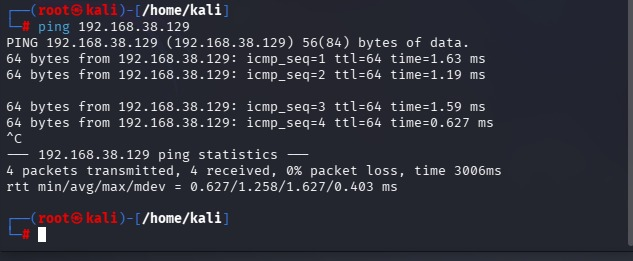

### Nmap scan

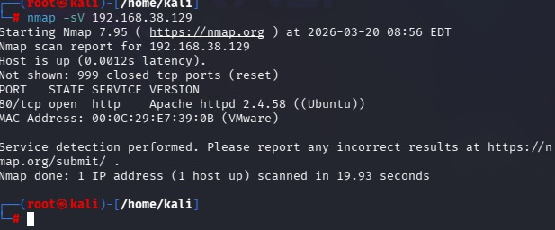

### Service detection (-sC -sV)

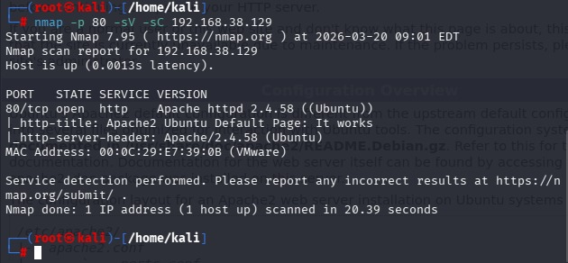

### Apache default page

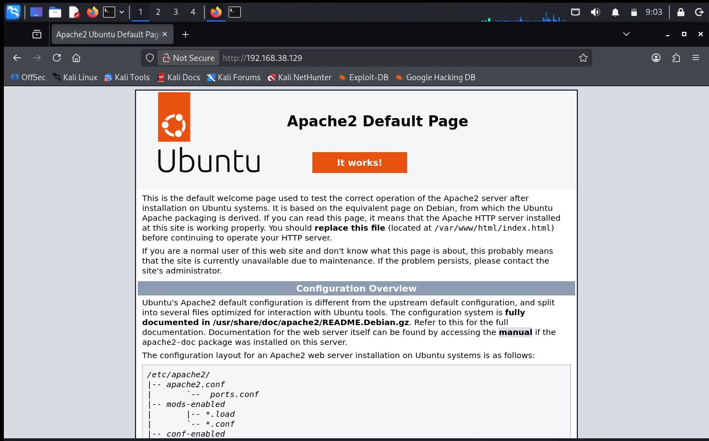

</details>

## Phase 2: Web enumeration

**Objective:** Analyse the web service for weaknesses and hidden resources, using WhatWeb, Nikto and Gobuster.

**Findings:**

- Apache version information exposed
- Default Apache page accessible
- Missing security headers (X-Frame-Options, X-Content-Type-Options)
- Potential information leakage through ETags
- Default and restricted directories present

<details>
<summary>Screenshots</summary>

### WhatWeb

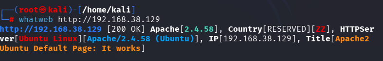

### Nikto

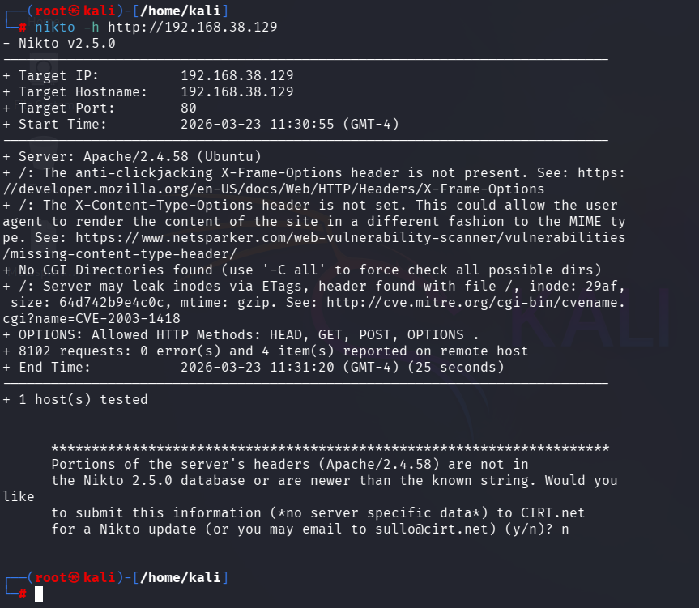

### Gobuster

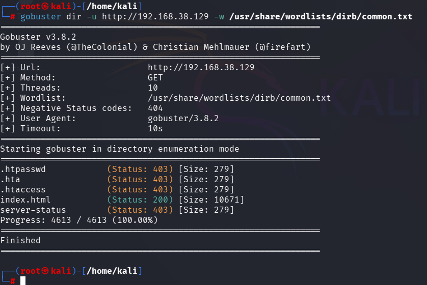

</details>

## Phase 3: System hardening

**Objective:** Reduce the attack surface.

1. **Apache configuration:** Edited `/etc/apache2/conf-available/security.conf` to hide version information. The file ended up with these two lines:

   ```apache
   ServerTokens Prod
   ServerTokens off
   ```

   The second line was meant to be `ServerSignature Off`. Phase 4 shows the effect.
2. **Default page:** Deleted `/var/www/html/index.html`.
3. **Firewall:** Enabled UFW and allowed only port 22 (SSH) and port 80 (HTTP).
4. **Updates:** Updated the system packages.

<details>
<summary>Screenshots</summary>

### Apache configuration before

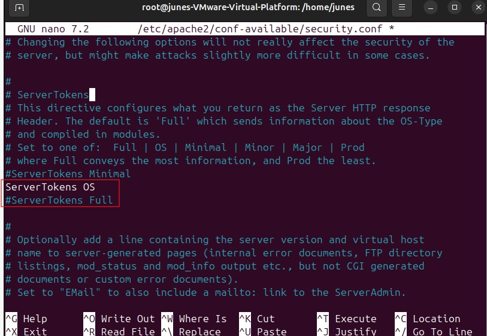

### Apache configuration after

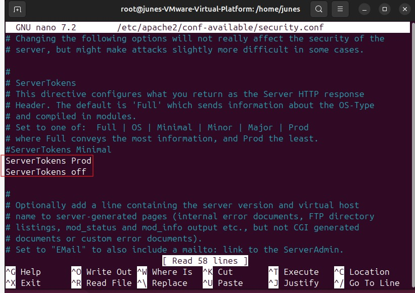

### Default page removal: verification

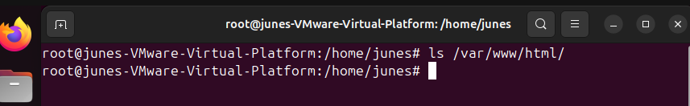

### Default page removal: result

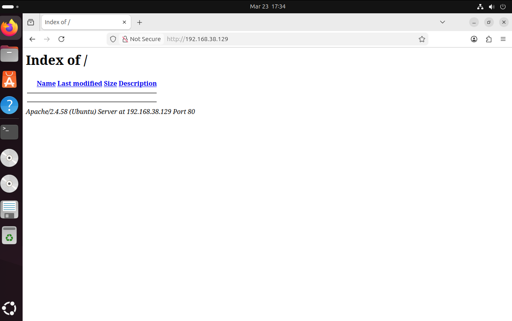

### UFW enabled

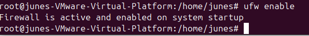

### UFW rules


### UFW status

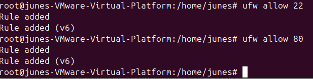

</details>

## Phase 4: Re-scan and validation

**Objective:** Verify whether the applied measures improved the security posture, by repeating the Nmap scan (`-sC -sV`), running Nikto and checking the HTTP headers with `curl -I`.

**Effective:**

- The firewall is active: Nmap now reports 998 filtered TCP ports
- The default Apache page is gone

**Not effective:**

| Finding | Evidence | Cause |
|---|---|---|
| Apache version still exposed | `Server: Apache/2.4.58 (Ubuntu)` in `curl -I`, Nmap and Nikto | The later `ServerTokens off` line overrides `ServerTokens Prod`. `off` is not a valid value, so Apache falls back to its default (`Full`) |
| Version still shown in the page footer | Footer of the `Index of /` page | `ServerSignature Off` was never set |
| New issue: directory listing | Browser shows `Index of /`, Nikto reports directory indexing | Removing `index.html` left the directory without an index page, and `Indexes` is enabled |
| Security headers still missing | Nikto: no X-Frame-Options, no X-Content-Type-Options | Not addressed in this run |

<details>
<summary>Screenshots</summary>

### Nikto after hardening

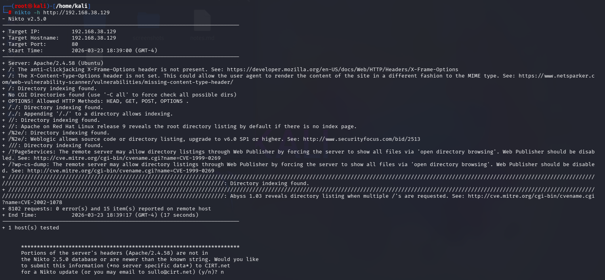

### HTTP headers after hardening

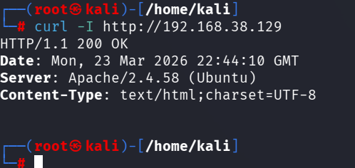

</details>

## Analysis

The firewall reduced the network exposure and the default page was removed. The information disclosure remained because of a single wrong configuration line, and removing the default page introduced a directory listing.

Without the re-scan, the hardening would have looked complete.

## Next run

Planned fixes, followed by the same re-scan:

```apache
# /etc/apache2/conf-available/security.conf
ServerTokens Prod
ServerSignature Off
Header set X-Frame-Options "SAMEORIGIN"
Header set X-Content-Type-Options "nosniff"
```

```apache
# Apache configuration for /var/www/
Options -Indexes
```

```bash
sudo a2enmod headers
sudo apache2ctl configtest
sudo systemctl reload apache2
```

## Key takeaways

- A hardening step is only finished once a re-scan confirms it.
- A fix can create a new finding, as the removed default page did.

## Disclaimer

This project was carried out in a controlled virtual lab environment for educational purposes only.
